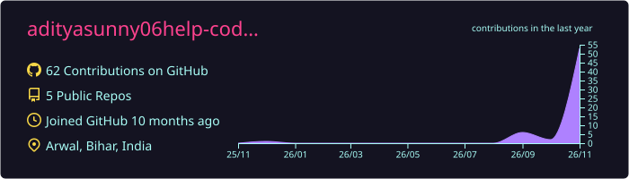
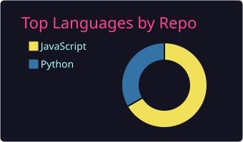
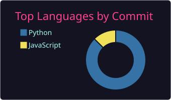
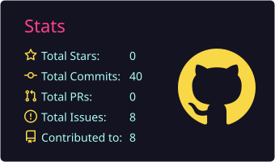
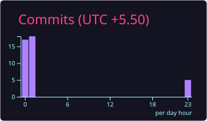

### Hi there  — welcome to my profile

> 💻 *"I don't guess vulnerabilities — I verify them first, then report them."*

 

**[🛡️ About](#-about-me) · [🏆 Achievements](#-achievements--recognition) · [🔧 Tech Arsenal](#-tech-arsenal) · [📌 Featured](#-featured-project) · [⚡ Activity](#-recent-github-activity) · [🌐 Connect](#-connect-with-me)**

 

<!-- SUMMARY-START -->

<b>📊 Detailed Profile Stats — click to expand (auto-updated daily, IST)</b>

 

 

 

<!-- SUMMARY-END -->

<b>🏆 GitHub Trophies — click to expand</b>

 

## 🛡️ About Me

- 🔍 **Independent Security Researcher & Bug Bounty Hunter** — hunting since 2024
- 💰 **$10,000 in total bug bounty rewards** across HackerOne, Bugcrowd, YesWeHack, Intigriti & Meta
- 🏢 **13 reports submitted to Microsoft MSRC** (.NET, Azure & Identity) — every finding locally reproduced before reporting
- 📱 Specialising in **Web, API & Android (APK) security** — access control, authentication & server-side flaws
- 🐙 **Open source:** Reported a Microsoft **OpenVMM** issue on GitHub — fix merged with a regression test
- 🎓 **ITI — ITSM (2023–2025)** · Class 10, CBSE — JNV Arwal (2023) · Class 12 — final in 2027
- 📍 Arwal, Bihar, India

### 🎯 Current Focus

- 🔭 Hunting on **Microsoft MSRC** programs — .NET, Azure & Identity product lines
- 📚 **CompTIA CySA+ (CS0-003)** — in progress (Pearson, via Coursera)
- ✍️ Writing security write-ups on [Medium](https://adityasunny06.medium.com)
- 🤝 Open to **cybersecurity internships** & security research collaborations

## 🏆 Achievements & Recognition

| Platform | Highlight |
|---|---|
| **Meta Bug Bounty** | $550 awarded — resolved report (Admin Removal Exploit) |
| **HackerOne** | Valid bugs — Meta (2/2), ABB (3/3), Samsung, Adobe, Audible, Napkin AI |
| **Bugcrowd** | 21 vulnerabilities · 66 points · **Hall of Fame in 5 programs** — Dell, Verisk, Xfinity Home & more |
| **YesWeHack** | Pine Labs Hall of Fame — **Rank 43** |
| **Intigriti** | Shop Apotheke leaderboard — **Rank 43** |
| **Bajaj Finserv** | Listed on the official **Security Heroes** acknowledgements page |
| **Microsoft MSRC** | 13 vulnerability reports across .NET, Azure & Identity |

  
  
  
  

### 🏅 Hall of Fame — Logo Wall

*Every logo below is a program that has recognised my work — Hall of Fame, valid findings, or an official acknowledgement.*

<table align="center">
  <tr>
    <td align="center" width="25%"> <b>Meta</b> Bug Bounty · $550 · HoF</td>
    <td align="center" width="25%"> <b>Dell Technologies</b> Bugcrowd — Hall of Fame</td>
    <td align="center" width="25%"> <b>Samsung</b> HackerOne · Valid</td>
    <td align="center" width="25%"> <b>Adobe</b> HackerOne · Valid</td>
  </tr>
  <tr>
    <td align="center" width="25%"> <b>ABB</b> HackerOne · 3/3 Valid</td>
    <td align="center" width="25%"> <b>Audible</b> HackerOne · Valid</td>
    <td align="center" width="25%"> <b>Verisk</b> Hall of Fame</td>
    <td align="center" width="25%"> <b>Xfinity Home &amp; xFi</b> Bugcrowd — Hall of Fame</td>
  </tr>
  <tr>
    <td align="center" width="25%"> <b>Pine Labs</b> YesWeHack HoF · Rank 43</td>
    <td align="center" width="25%"> <b>Shop Apotheke</b> Intigriti · Rank 43</td>
    <td align="center" width="25%"> <b>Bajaj Finserv</b> Security Heroes</td>
    <td align="center" width="25%"> <b>Napkin AI</b> HackerOne · Valid</td>
  </tr>
  <tr>     <td align="center" width="25%"> <b>Viator</b> Bugcrowd — Hall of Fame</td>     <td align="center" width="25%"> <b>Linktree</b> Bugcrowd — Hall of Fame</td>     <td align="center" width="25%"> <b>Majid Al Futtaim Lifestyle</b> Bugcrowd — Hall of Fame</td>     <td align="center" width="25%"> <b>Bugcrowd</b> 21 vulns · 66 points · 5× HoF</td>   </tr> </table>

## 🔧 Tech Arsenal

  

| Category | Stack |
|---|---|
| **Offensive Tools** | Burp Suite · Nuclei · Subfinder · httpx · Katana · Nmap · jadx · Frida (basics) |
| **Expertise** | Web & API Security (OWASP) · IDOR / Access Control · Authentication Flaws · SSRF · XSS · SQLi |
| **Reporting** | CVSS 3.1 Scoring · Dynamic Verification · PoC Writing |
| **Systems** | Linux · Windows · Networking Fundamentals · IT Systems Maintenance |
| **Scripting** | Python · Bash |

## 📌 Featured Project

🛡️ **Suraksha Setu — Scam Shield:** paste any link / UPI ID / message before tapping, get a 0–100 risk score with Hinglish reasons and a Hindi voice alert.

## ✍️ Latest on Medium

<!-- BLOG-POST-LIST:START -->
- [CI/CD Takeover &amp; Supply Chain Risk! $$$$ Bounty](https://infosecwriteups.com/linktrees-entire-mobile-infrastructure-exposed-hardcoded-secrets-in-strings-xml-bb881b0a86d7?source=rss-b8ebb8852210------2)
- [How Pakistani TV Channels Were Hijacked](https://adityasunny06.medium.com/how-pakistani-tv-channels-were-hijacked-b062e63aafe1?source=rss-b8ebb8852210------2)
- [A chain of Google Docs flaws leads to one‑click Drive folder/file hijack — $4,133.70](https://infosecwriteups.com/a-chain-of-google-docs-flaws-leads-to-one-click-drive-folder-file-hijack-4-133-70-060a3108769e?source=rss-b8ebb8852210------2)
- [XSS in Google IDX Workstation → RCE! $22,500 Bounty Earned](https://infosecwriteups.com/xss-in-google-idx-workstation-rce-22-500-bounty-earned-2d09f0176869?source=rss-b8ebb8852210------2)
- [I Leaked Keywords from Google Drive with a Tiny Side‑Channel ⚡ &lpar;$5,000 Bounty&rpar;](https://infosecwriteups.com/i-leaked-keywords-from-google-drive-with-a-tiny-side-channel-5-000-bounty-480ab5b97bf5?source=rss-b8ebb8852210------2)
<!-- BLOG-POST-LIST:END -->

*This list auto-updates from my Medium feed — no manual edits needed.*

## ⚡ Recent GitHub Activity

<!--START_SECTION:activity-->
1. 🗣 Commented on [#1224](https://github.com/TomBursch/kitchenowl/pull/1224#issuecomment-6861639170) in [TomBursch/kitchenowl](https://github.com/TomBursch/kitchenowl)
2. ℹ️ Labeled issue [#8147](https://github.com/louislam/uptime-kuma/issues/8147) in [louislam/uptime-kuma](https://github.com/louislam/uptime-kuma)
3. ❗ Opened issue [#8147](https://github.com/louislam/uptime-kuma/issues/8147) in [louislam/uptime-kuma](https://github.com/louislam/uptime-kuma)
4. ℹ️ Assigned issue [#8147](https://github.com/louislam/uptime-kuma/issues/8147) in [louislam/uptime-kuma](https://github.com/louislam/uptime-kuma)
5. ℹ️ Assigned issue [#8146](https://github.com/louislam/uptime-kuma/issues/8146) in [louislam/uptime-kuma](https://github.com/louislam/uptime-kuma)
6. ℹ️ Labeled issue [#8146](https://github.com/louislam/uptime-kuma/issues/8146) in [louislam/uptime-kuma](https://github.com/louislam/uptime-kuma)
7. ❗ Opened issue [#8146](https://github.com/louislam/uptime-kuma/issues/8146) in [louislam/uptime-kuma](https://github.com/louislam/uptime-kuma)
8. ℹ️ Assigned issue [#8145](https://github.com/louislam/uptime-kuma/issues/8145) in [louislam/uptime-kuma](https://github.com/louislam/uptime-kuma)
<!--END_SECTION:activity-->

*This section auto-updates with my latest public GitHub activity.*

## 🌐 Connect With Me

  
  
  
  
  

